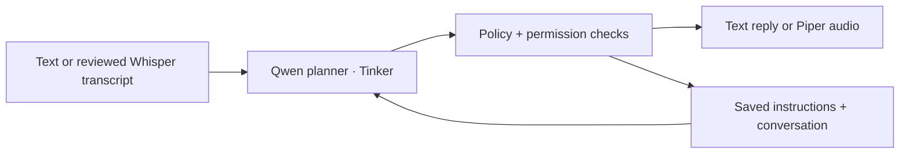

# GuardMate

An AI delivery assistant for PG life: remember the handoff instructions, handle
courier conversations, and ask the resident before changing the plan.

**[Open GuardMate](https://guardmate.onrender.com)** · [Watch the demo](#demo) ·
[How it works](#how-i-built-it)

Built for **Hacktoberfest 2026 · Build for a Friend**.

The idea came from a friend who lives in paying guest accommodation (PG) and
gets courier calls while at the office. His usual answer is simple: **leave the
prepaid parcel with security at the guard room near the entrance**. Missed calls
can mean returned parcels. GuardMate remembers that instruction, checks today's
availability, and keeps each delivery conversation separate.

## Demo

Watch GuardMate in action:

https://github.com/user-attachments/assets/9e87d2ac-5c21-44d7-9091-4c37eca1e539

[Repository walkthrough (MP4)](docs/media/guardmate-demo.mp4) ·
[Call recording (MP3)](docs/media/guardmate-call-recording.mp3)

The call recording is shared with all speakers' permission.

## Using GuardMate

The public website is live, and account-linked Windows installers are available
for supervised testing. Google sign-in is required for downloads; viewing the
website and its prepared conversation example is public.

1. **Visit** [GuardMate](https://guardmate.onrender.com). The public website has
   a prepared conversation example; Google sign-in authorizes your download.
2. **Install** your personalized `GuardMateSetup.exe`. Setup installs the
   application and verifies its speech-model downloads. The initial installer
   is unsigned, so Windows may show a publisher warning.
3. **Connect** your Android phone through Microsoft Phone Link. Complete
   Microsoft sign-in, Bluetooth pairing and call permissions when prompted.
4. **Configure** the resident's name, PG details, guard-room directions, routine
   and current delivery window in the local dashboard.
5. **Select** the paired phone's input and output audio devices. Answer a
   consenting call manually through Phone Link, then start assistance.
6. **Review** each captured transcript, edit it if needed, and send it for an AI
   reply. Choose **Play** separately to transmit the checked reply to the caller.
7. **Decide** using **Approve once**, **Decline** or **Handle personally** when
   resident input is required. Stop assistance and hang up through Phone Link.

Requirements are Windows x64, an Android phone, Bluetooth and internet access.
Users do not need Python, Node.js or their own Tinker key. The local dashboard
also supports fictional text and browser-microphone role-play for practice.
Pairing and phone permissions remain interactive.

GuardMate checks proposed replies against the saved instructions. Alternative
locations need an expiring resident approval; payment, OTP, signature and
high-value exceptions pause the handoff for the resident.

Each account receives a **$1 lifetime estimated AI allowance**, provided by the
project owner. Reinstalling, downloading again or copying an account's installer
uses that same account and allowance. Downloads can be revoked through the
website. [Desktop usage and release guide](docs/desktop-release.md).

## How I built it

I started with the friend's repeated delivery instructions, then modelled the
resident's routine, temporary availability, parcel facts and approvals as
application state. The planner receives that context and the courier's
conversation, rather than treating each message as an isolated classification.

Open-weight **Qwen3.5-4B**, served through **Tinker**, proposes structured actions.
The Python engine validates them against the resident's policy and current
conversation before saving a decision or returning a reply. The model proposes;
the application owns permissions and execution.

I separated the application into a Windows client and a cloud gateway.
**whisper.cpp** transcribes speech and **Piper** generates replies in local
workers. **SQLite** saves each account's resident preferences and conversation
history on the computer. Reviewed text, history and resident context go through
Render to Tinker for planning; the application is not fully offline.

The Render **FastAPI** gateway serves the public React website, verifies Google
identity and enforces each account's allowance. **MongoDB Atlas** holds account
identities, hashed download credentials, expiring sessions and request ledgers.
A MongoDB transaction reserves a conservative token-cost estimate before a
request can reach Tinker. Concurrent copies share the account's remaining
allowance; duplicate or uncertain requests are never automatically resent.

I packaged the desktop runtime with **PyInstaller** and a small Windows
bootstrapper. **Cloudflare R2** stores the common application package and unsigned
installer template privately. After login, the gateway personalizes the template
with a revocable account credential. Setup activates that credential, verifies
the downloaded package and protects the installed session with Windows DPAPI.
Tinker, database, Google client-secret and R2 secrets stay server-side or in
private publishing configuration; they are excluded from the distributed app.

## Tech stack

| Layer                 | Technologies                                                       |
| --------------------- | ------------------------------------------------------------------ |
| Website and dashboard | React 19, TypeScript, Vite                                         |
| API and validation    | Python 3.13, FastAPI, Pydantic, Uvicorn                            |
| Delivery planning     | Qwen3.5-4B through Tinker; structured plans and application checks |
| Local persistence     | SQLite; account-specific preferences and history                   |
| Cloud accounting      | MongoDB Atlas, PyMongo transactions; per-account reservations      |
| Speech recognition    | Local whisper.cpp `base.en`                                        |
| Speech synthesis      | Local Piper `en_US-ljspeech-high`, ONNX Runtime                    |
| Windows distribution  | PyInstaller, Windows bootstrapper, DPAPI, private Cloudflare R2    |
| Identity and hosting  | Google OAuth with PKCE, Docker on Render                           |
| Phone integration     | Windows Phone Link, Bluetooth audio, selected WDM-KS endpoints     |
| Training and quality  | Tinker LoRA, fictional delivery scenarios, pytest, Vitest, Ruff    |

## What we tested

We wrote fictional multi-turn delivery scenarios, tested the policy engine with
fake providers and audio devices, then compared real model proposals with the
application's checked outcomes. Regression coverage includes isolated histories,
grounded parcel facts, approval expiry, stale responses, budget reservations and
voice cleanup. [Dataset](datasets/delivery/DATASET_CARD.md) ·
[Evaluation guide](docs/evaluation.md).

On **October 4, 2026**, one consenting fictional **Windows Phone Link CLI call** worked on a vivo T2x 5G
(Android 15). The caller heard the greeting and three checked Qwen replies. The
operator reviewed transcripts, and an ambiguous final transcript was rejected
instead of recording a completed delivery. [Call report](docs/live-cellular-test-2026-10-04.md).

The **October 4, 2026 LoRA pilot** trained 40 fictional planner targets over 30 updates. On six
development scenarios, planner agreement changed from **7/13 to 8/13**, while
checked scenario success stayed **5/6**. This is a small development result, not
field accuracy or a demonstrated functional improvement. Base Qwen remains the
default; a trained checkpoint must be selected explicitly. The demo's fixed
fine-tuned-model heading is not evidence of the runtime checkpoint.
[Pilot report](docs/pilot-2026-10-04.md) · [Model selection](docs/model-selection.md).

The earlier hosted prototype, documented on **October 13, 2026**, passed
authentication, Atlas persistence and a synthetic English speech round-trip.
Synthesis took about **14.3 seconds** and transcription **14.9 seconds** on that
Render instance. Those historical measurements describe the previous hosted
speech path, not the local Windows package or latency guarantees.
[Deployment notes](docs/render-deployment.md#historical-hosted-prototype).

## Privacy and current limits

Each desktop profile serves one resident and is **for supervised use**. Courier labels
do not verify caller identity, and a courier's reported delivery is not proof of
receipt. There is no automatic answering, hangup, transfer or barge-in.
Transcription can fail, and automatic turn-taking has not been validated on a
live call. It is not ready for unattended real deliveries.

The desktop keeps preferences and history locally. New cloud account records
contain identity and accounting data, not resident histories or audio. The cloud
gateway does not expose the previous hosted resident-data APIs or their records.
Speech workers use temporary local audio files; Tinker receives submitted text,
history and resident context.
Credentials, model weights, runtime recordings and checkpoints are excluded
from Git; the consented demo media above is intentionally public.

The **$1 allowance is per account**, rather than per physical person or device.
Completed and uncertain requests retain conservative estimated reservations;
this is not the provider's invoice balance. Existing historical spending records
are preserved separately. The packaged GUI still needs a supervised real-call
check on each new phone/computer; the older CLI call does not establish broad
device compatibility. [Speech processing and licences](docs/browser-voice.md).

## Explore the project

- [Desktop release](docs/desktop-release.md): installation, account downloads,
  Phone Link use and release publishing.
- [Local development](docs/local-development.md): running the source app
  and verification commands.
- [Render and Atlas deployment](docs/render-deployment.md): hosting and server
  configuration.
- [Browser voice](docs/browser-voice.md), [cellular calls](docs/manual-cellular-call.md)
  and [automatic turn-taking](docs/automatic-cellular-call.md).
- [Training](docs/training.md) and [speech replay](docs/speech-replay.md): planner
  experiments and audio evaluation.
- [DEV submission](docs/dev-submission.md) and [submission checklist](docs/submission-checklist.md).
