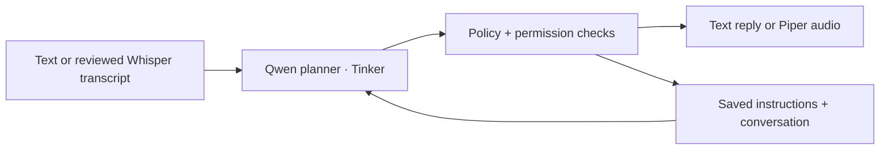

# GuardMate

An AI delivery assistant for PG life: remember the handoff instructions, handle
courier conversations, and ask the resident before changing the plan.

**[Open GuardMate](https://guardmate.onrender.com)** · [Watch the demo](#demo) ·
[How it works](#how-we-built-it)

Built for **Hacktoberfest 2026 · Build for a Friend**.

The idea came from a friend who lives in paying guest accommodation (PG) and
gets courier calls while at the office. His usual answer is simple: **leave the
prepaid parcel with security at the guard room near the entrance**. Missed calls
can mean returned parcels. GuardMate remembers that instruction, checks today's
availability, and keeps each delivery conversation separate.

## Demo

Watch GuardMate in action:

https://github.com/user-attachments/assets/9e87d2ac-5c21-44d7-9091-4c37eca1e539

[Repository walkthrough (MP4)](docs/media/guardmate-demo.mp4) ·
[Call recording (MP3)](docs/media/guardmate-call-recording.mp3)

The call recording is shared with all speakers' permission.

## Using GuardMate

1. **Open the [live app](https://guardmate.onrender.com).** Sign in with the
   dashboard credentials provided by the project owner.
2. **Make it yours.** Save the resident's name, PG details, guard-room directions
   and office routine.
3. **Set today's availability.** Choose **At office**, **At PG** or **Ask me first**
   when today's plan differs from the usual routine.
4. **Enable delivery mode.** Set a delivery window and switch delivery mode on.
5. **Start a fictional courier role-play.** Open text role-play, give the session
   a courier label, and send delivery messages. Each session has its own history,
   parcel facts and resident decisions. Saved conversations can be reopened.
6. **Make the resident's decisions separately.** Use **Approve once**, **Decline**
   or **Handle personally** when a handoff needs your input. End the role-play
   when you are done.

For voice, choose **Record courier message**, then **Stop recording**. Review
and edit the transcript, choose **Use transcript**, then **Send**.
**Listen to latest reply** plays the assistant's saved response. Recording and
sending are manual; browser microphone permission is required.

GuardMate checks proposed replies against the saved instructions. Alternative
locations need an expiring resident approval; payment, OTP, signature and
high-value exceptions pause the handoff for the resident.

The hosted app supports text and browser voice. The optional **Windows Phone
Link** integration is a separate local call path: an operator still answers and
hangs up the call. Experimental automatic turn-taking starts only after a
manually answered call. [Cellular call guide](docs/manual-cellular-call.md).

## How I built it

I started with the friend's repeated delivery instructions, then modelled the
resident's routine, temporary availability, parcel facts and approvals as
application state. The planner receives that context and the courier's
conversation, rather than treating each message as an isolated classification.

Open-weight **Qwen3.5-4B**, served through **Tinker**, proposes structured actions.
The Python engine validates them against the resident's policy and current
conversation before saving a decision or returning a reply. The model proposes;
the application owns permissions and execution.

**whisper.cpp** transcribes speech and **Piper** generates replies in backend
workers. On Render, audio is processed on the hosted backend; in local
development, those workers run on your computer. Recognized text, conversation
history and resident context go to Tinker for planning. The application is not
fully offline.

The React dashboard and FastAPI API share one origin in the Docker deployment.
**MongoDB Atlas** stores hosted preferences, conversations and the inference
budget. Local development also supports Atlas, with SQLite as the fallback when
MongoDB is not configured. Dashboard authentication and server-side environment
variables keep deployment credentials out of frontend assets and Git.

## Tech stack

| Layer                | Technologies                                                       |
| -------------------- | ------------------------------------------------------------------ |
| Dashboard            | React 19, TypeScript, Vite                                         |
| API and validation   | Python 3.13, FastAPI, Pydantic, Uvicorn                            |
| Delivery planning    | Qwen3.5-4B through Tinker; structured plans and application checks |
| Persistence          | MongoDB Atlas, PyMongo; optional local SQLite                      |
| Speech recognition   | whisper.cpp; hosted `base.en` model quantized to Q5_0              |
| Speech synthesis     | Piper `en_US-ljspeech-high`, ONNX Runtime                          |
| Hosting              | Docker on Render, one backend worker, HTTPS dashboard login        |
| Local cellular route | Windows Phone Link, Bluetooth audio, pinned WDM-KS devices         |
| Training and quality | Tinker LoRA, fictional delivery scenarios, pytest, Vitest, Ruff    |

## What we tested

We wrote fictional multi-turn delivery scenarios, tested the policy engine with
fake providers and audio devices, then compared real model proposals with the
application's checked outcomes. Regression coverage includes isolated histories,
grounded parcel facts, approval expiry, stale responses, budget reservations and
voice cleanup. [Dataset](datasets/delivery/DATASET_CARD.md) ·
[Evaluation guide](docs/evaluation.md).

One consenting fictional **Windows Phone Link call** worked on a vivo T2x 5G
(Android 15). The caller heard the greeting and three checked Qwen replies. The
operator reviewed transcripts, and an ambiguous final transcript was rejected
instead of recording a completed delivery. [Call report](docs/live-cellular-test-2026-10-04.md).

One **LoRA pilot** trained 40 fictional planner targets over 30 updates. On six
development scenarios, planner agreement changed from **7/13 to 8/13**, while
checked scenario success stayed **5/6**. This is a small development result, not
field accuracy or a demonstrated functional improvement. Base Qwen remains the
default; a trained checkpoint must be selected explicitly. The demo's fixed
fine-tuned-model heading is not evidence of the runtime checkpoint.
[Pilot report](docs/pilot-2026-10-04.md) · [Model selection](docs/model-selection.md).

The hosted deployment also passed authentication, Atlas persistence and a
synthetic English speech round-trip. On the tested Render instance, synthesis
took about **14.3 seconds** and transcription **14.9 seconds**; these are single
test measurements, not latency guarantees. [Deployment notes](docs/render-deployment.md).

## Privacy and current limits

GuardMate is a **single-resident prototype for supervised use**. Courier labels
do not verify caller identity, and a courier's reported delivery is not proof of
receipt. There is no automatic answering, hangup, transfer or barge-in.
Transcription can fail, and automatic turn-taking has not been validated on a
live call. It is not ready for unattended real deliveries.

Hosted history is stored in Atlas. Speech workers use temporary audio files;
the hosted planner receives submitted text, history and resident context.
Credentials, model weights, runtime recordings and checkpoints are excluded
from Git; the consented demo media above is intentionally public.

Inference has a persistent **$0.25 estimated reservation cap**, separate from
provider billing and training accounting. Uncertain requests are not
automatically retried. [Voice processing and licences](docs/browser-voice.md).

## Explore the project

- [Local development](docs/local-development.md): installation, running the app
  and verification commands.
- [Render and Atlas deployment](docs/render-deployment.md): hosting and server
  configuration.
- [Browser voice](docs/browser-voice.md), [cellular calls](docs/manual-cellular-call.md)
  and [automatic turn-taking](docs/automatic-cellular-call.md).
- [Training](docs/training.md) and [speech replay](docs/speech-replay.md): planner
  experiments and audio evaluation.
- [DEV submission](docs/dev-submission.md) and [submission checklist](docs/submission-checklist.md).
